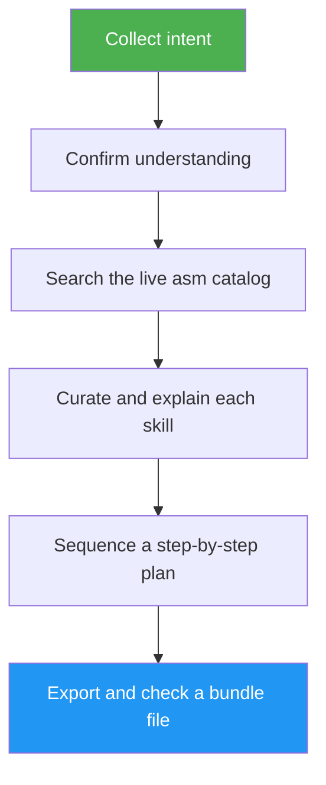

<!--
  DO NOT READ THIS FILE — This README.md is for human catalog browsing only.
  It ships inside the .skill package but is NEVER auto-loaded into agent context.
  The runtime loader only reads SKILL.md + references/ + scripts/ + agents/ when the skill triggers.
  If you're an AI agent, read the SKILL.md file instead for skill instructions.
-->

# Find Me Skills

> Find Agent Skills for a goal you cannot name yet, then export an installable bundle.

## Highlights

- Draws out your goal in plain language and plays it back for you to confirm before it searches anything
- Searches the live `asm` catalog (`asm search --available --json`); never guesses skill names or install URLs
- Turns the matches into a step-by-step path, with the input and output of each step
- Exports one `asm` bundle file on your approval, checks it with `asm bundle show`, and leaves out skills you already have
- Self-Improve: at the end of a run, the agent may propose one edit that adapts the skill to your style, environment, and behavior — optional, and applied only when you approve

## When to Use

| Say this...                                           | Skill will...                                                     |
| ----------------------------------------------------- | ----------------------------------------------------------------- |
| "Which skills would help me market my app?"           | Confirm the goal, search the catalog, propose a sequenced plan    |
| "I'm building a SaaS and don't know where to start"   | Ask what you need, then map it onto installable skills            |
| "Is there a skill that converts PDFs?"                | Run one catalog search and give the matching `asm install` line   |
| "Bundle those skills so I can install them in one go" | Write a bundle file and give you the `asm bundle install` command |

Don't use for: installing skills you can already name (`asm install`), authoring skills (`skill-creator`), or catalog maintenance (`refresh-index`, `skill-index-updater`).

## How It Works



## Usage

```
/find-me-skills
```

Requires the `asm` CLI on PATH (`npm install -g agent-skill-manager`).

## Resources

| Path                              | Description                                                              |
| --------------------------------- | ------------------------------------------------------------------------ |
| `references/catalog-discovery.md` | `asm search` JSON shape, installed-vs-available rules, empty results     |
| `references/bundle-format.md`     | The `BundleManifest` template, validation rules, and why it uses bundles |

## Output

- A numbered plan: each step names a skill, its purpose for your goal, and its input and output
- On approval, a `<goal>.bundle.json` file in the current directory, checked with `asm bundle show`
- The install command to run yourself: `asm bundle install ./<goal>.bundle.json`
