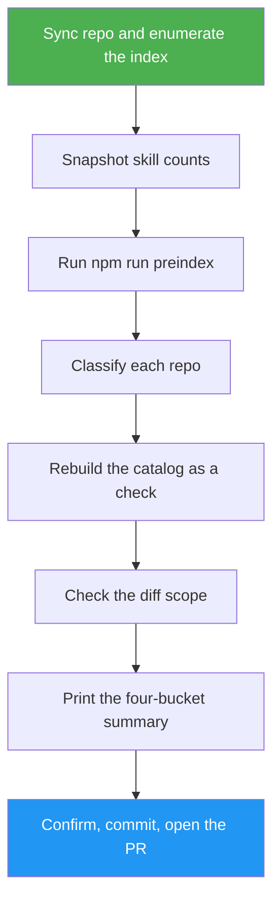

<!--
  DO NOT READ THIS FILE — This README.md is for human catalog browsing only.
  It ships inside the .skill package but is NEVER auto-loaded into agent context.
  The runtime loader only reads SKILL.md + references/ + scripts/ + agents/ when the skill triggers.
  If you're an AI agent, read the SKILL.md file instead for skill instructions.
-->

# Refresh Index

> Sync every enabled repo in the curated skill index and open a confirmation-gated PR.

## Highlights

- Re-ingests every enabled repo in `data/skill-index-resources.json` with `npm run preindex`, pointing `ASM_CONFIG_DIR` at a scratch directory so your real config is untouched
- Sorts each repo into updated, unchanged, failed, or skipped, comparing with timestamps stripped so re-stamped files do not count as changes
- Rebuilds the website catalog as a check only, then restores the tracked files the rebuild rewrites
- Stops when the diff reaches beyond `data/skill-index/`, and commits only after you answer `yes`
- Self-Improve: at the end of a run, the agent may propose one edit that adapts the skill to your style, environment, and behavior — optional, and applied only when you approve

## When to Use

| Say this...                      | Skill will...                                                  |
| -------------------------------- | -------------------------------------------------------------- |
| "Refresh the index"              | Re-ingest every enabled repo and print the four-bucket summary |
| "Sync the catalog with upstream" | Same flow, then ask before opening the data-only PR            |
| "Re-ingest all indexed repos"    | Refresh, verify the catalog rebuilds, and gate the commit      |

Don't use for: adding a new repo (`skill-index-updater`), improving a single skill (`skill-creator`), or installing skills locally (`asm install`, `asm update`).

## How It Works



## Usage

```
/refresh-index
```

Run it inside the `agent-skill-manager` repo with `node`, `npm`, `git`, and an authenticated `gh` on PATH.

## Resources

| Path                             | Description                                                    |
| -------------------------------- | -------------------------------------------------------------- |
| `references/snapshot.md`         | Loop that records each repo's skill count before the refresh   |
| `references/classify.md`         | Timestamp-stripped comparison and the four-bucket signal table |
| `references/summary-template.md` | Markdown template for the refresh summary                      |
| `references/commit-and-pr.md`    | Branch step, commit message, and `gh pr create` body           |
| `references/edge-cases.md`       | Failure conditions and the required response for each          |

## Output

- A four-bucket summary (updated, unchanged, failed, skipped) with before/after skill counts
- On `yes`, one data-only PR touching `data/skill-index/` only; `website/catalog.json` is never staged
