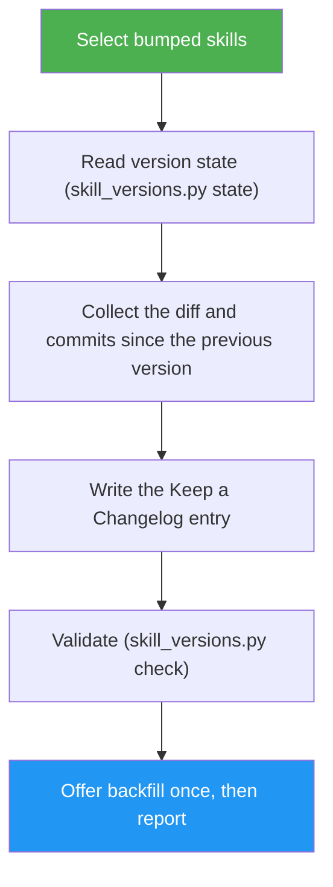

<!--
  DO NOT READ THIS FILE — This README.md is for human catalog browsing only.
  It ships inside the .skill package but is NEVER auto-loaded into agent context.
  The runtime loader only reads SKILL.md + references/ + scripts/ + agents/ when the skill triggers.
  If you're an AI agent, read the SKILL.md file instead for skill instructions.
-->

# Skill Changelog

> Writes a skill's own CHANGELOG.md entry from its git diff every time its version is bumped.

## Highlights

- Builds the entry from the skill's git diff and commit subjects since the previous version, not from memory
- Keep a Changelog 1.1.0 format, newest first, in `CHANGELOG.md` inside the skill folder, so the history ships with every install
- Idempotent: a version that already has an entry is never written twice
- Offers once to backfill missing versions from git history, or backfills on request
- Handles renamed skill folders, shallow clones (blocks), and versions bumped twice before commit
- Writes files only; never commits

## When to Use

| Say this... | Skill will... |
| --- | --- |
| (automatic, right after a skill's version bump) | Write the entry for the bumped version |
| "/skill-changelog skills/my-skill" | Write the entry for that skill's current version |
| "write the changelog entry for this skill" | Find the bumped skill and write its entry |
| "/skill-changelog skills/x --backfill" | Reconstruct every missing version's entry from git |

## How It Works



## Usage

```
/skill-changelog [<skill-dir>...]
```

## Resources

| Path | Description |
| --- | --- |
| `references/entry-format.md` | Header, entry template, diff-to-section mapping, bullet rules |
| `references/backfill.md` | Reconstructing earlier entries from git history |
| `references/edge-cases.md` | Expected result for renames, double bumps, shallow clones and other edge inputs |
| `scripts/skill_versions.py` | `state`, `history` and `check` subcommands (stdlib Python, JSON output) |

## Output

An updated (or new) `<skill-dir>/CHANGELOG.md`, left uncommitted, and a short report: result, range, sections written, the check result, and what was inferred.
